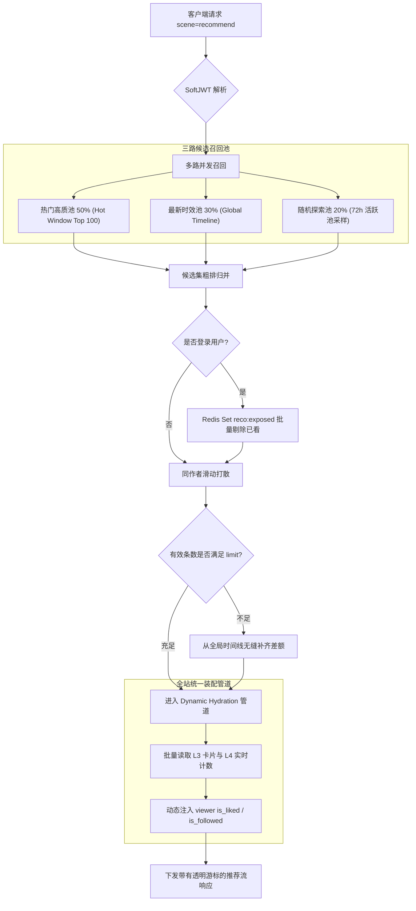
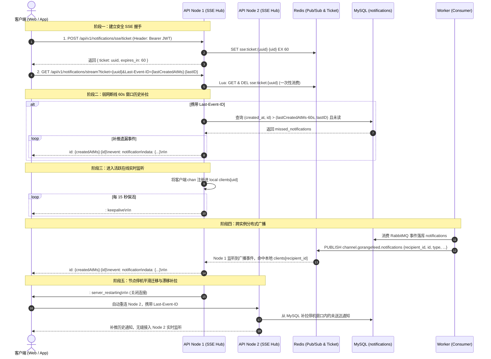

# GoRangeFeed 核心架构决策与跨项目技术演进规范（ADR & Reference Analysis）

> 本文档用于深度沉淀 GoRangeFeed 系统的跨项目方案对比（与 `GCFeed`、`feedsystem_video_go` 等标杆项目对比）、关键技术演进决策、数据库迁移与索引精细化设计、接口规范与核心边界验收用例。  
> 任务推进进度与状态跟踪请参阅 [docs/PROGRESS.md](file:///home/tide/GoProjects/GOrangeFeed/docs/PROGRESS.md)。

---

## 一、M3 全局最新 Feed 流架构决策

### 1.1 跨项目对比与方案优化决策

| 维度 | `feedsystem_video_go` 实现 | `GCFeed` 实现 | GoRangeFeed 优化决策（取长补短） |
|---|---|---|---|
| **排序权威源与游标设计** | 使用发布毫秒戳 `CreateTime.UnixMilli()` 作为 ZSet score 与游标；存在**同毫秒多视频并发写入时的碰撞丢失与重叠问题**。 | 使用 `published_at + video_id` 复合游标编码为 Base64；无 ZSet 时间线，依赖 DB 索引扫描。 | **单调 ID 统一游标**：严格利用自增主键 `video.id`（单调递增）作为 score 与 cursor（`score = video.id`），天然杜绝毫秒碰撞、时区漂移与浮点数精度损耗，前端透明易解析。 |
| **滑动窗口与边界维护** | 每次读请求执行 `ZRangeWithScores(0, 0)` 获取尾部水印，存在**高频额外 RTT**；且无原子裁剪。 | 无滑动窗口 ZSet。 | **Lua 原子裁剪 + 独立 Floor 缓存**：通过后台任务计算 72h Floor，采用 Lua 脚本原子执行 `ZREMRANGEBYSCORE` 裁剪与 `SET timeline:floor`，读路径直接 `GET timeline:floor`，杜绝冗余 `ZRange` 开销。 |
| **冷热无缝拼接 (Stitching)** | **【优点】** 当 ZSet 热区数据不足 `limit` 时，计算 `remainLimit = limit - len(hotVideos)` 并回源 DB 拼接冷区。 | 无冷热拼接机制，全量走 DB 过滤或页缓存。 | **【吸纳长处】** 完整采纳并规范化冷热拼接算法：热区扫描不足时，以最后扫描到的冷区边界 ID 为游标无缝向 MySQL 补齐差额数据，保证每页数量对齐。 |
| **已下架/软删除视频处理** | **【短板】** 遇到非发布状态仅在内存中剔除，游标依然停留在有效条目，导致后续翻页**反复空转扫描已删视频**，且返回条数不足。 | 依赖 DB 联合索引过滤 `status = published`。 | **【弥补短板】推进扫描指针（`NextCursor = lastScannedID`）**：批量探测 `max(limit*2, 50)`，遇到已下架内容自动后移补齐（单次扫描上限 500 条），且无论是否有效，游标均推至最后探测的 VideoID，彻底根治重复扫描。 |
| **缓存分层架构** | 仅使用本地缓存（go-cache）+ Redis 缓存单实体视频，缺少轻量页缓存，高并发下所有请求仍穿透 ZSet。 | **【优点】** 采用工业级 L1 页缓存（5s/45s）+ L3 卡片（15m）+ L4 计数（15s），按实体与动态计数分离。 | **【吸纳长处并增强】** 采纳 L1/L3/L4 分层模型，同时引入 **逻辑过期（Logical Expiration）+ Singleflight 进程内防击穿**：未命中时单协程回源，过期在 30s 容忍窗口内快速返回旧值并在后台异步刷新，保障极低 P99 延迟。 |
| **鉴权与上下文注入** | 登录态与游客态隔离，但缺少规范化软鉴权中间件。 | 接口允许匿名访问。 | **标准 `SoftJWTAuth` 软鉴权**：同时兼容 Header 与 URL Query `?token=`，匿名请求返回通用公共流，登录用户自动注入上下文（为 M4 点赞/关注态打下基础）。 |

---

## 二、M4 互动、推拉关注流与 Outbox 事务消息架构决策

### 2.1 跨项目对比与方案优化决策

| 维度 | `feedsystem_video_go` 实现 | `GCFeed` 实现 | GoRangeFeed 优化决策（取长补短与演进） |
|---|---|---|---|
| **点赞并发与原子一致性** | 先查后改（Check-then-act 竞态），尝试先投 MQ 失败再回退 DB 事务（存在双写一致性与网络抖动丢失风险）；在 `videos` 主表直接递增，高频行锁竞争严重。 | 仅提供观看与曝光流水，无独立点赞互动模块。 | **RowsAffected 驱动原子同步**：在单一事务中执行 `INSERT ... ON DUPLICATE KEY UPDATE` / `DELETE`，严格依据驱动返回的 `RowsAffected == 1` 判断真实状态变更，原子更新垂直拆分的 `video_stats.like_count`（`GREATEST` 防负数），Outbox 事务同城落库，禁止 `clientFoundRows=true`，兼顾强一致性与 300 并发性能。 |
| **已赞作品列表与游标分页** | 使用 `JOIN likes ON likes.video_id = videos.id WHERE likes.account_id = ? ORDER BY likes.created_at DESC LIMIT 200`，硬编码 200 条上限，无游标分页机制。 | 无已赞作品流。 | **单调 ID 游标流**：在 `likes` 表建立 `(user_id, id DESC)` 专属索引，采用单调递减的主键 ID 作为游标（`likes.id < cursor`）关联视频实体倒序翻页，支持无界、稳定且防深分页的已赞列表流。 |
| **评论发布幂等与层级回复** | 依赖 `commentMQ` 异步消费写入 DB，写接口仅返回 accepted，前端无法即时拿到评论实体；缺少客户端幂等防重；仅支持单层平铺评论。 | 无评论模块。 | **同步落库 + 客户端 Idempotency 唯一索引**：写请求同步完成权威落库并即刻返回新评论实体；通过 `UNIQUE (user_id, idempotency_key)` 约束拦截客户端超时重试；支持基于 `parent_id` 的二级单层回复与作者软删除原子递减计数；支持最新时间流与热评复合游标双模分页。 |
| **用户关系与统计（关注/粉丝）** | 无用户关系与关系统计模块。 | **【优点】** 采用领域驱动设计划分 `relation` 边界，独立 `user_relation_stat` 表隔离行锁；<br>**【短板】** 关系表采用软状态 `status=1/2` 导致索引膨胀，游标采用复合 Base64 时间戳易发生同秒碰撞。 | **【吸纳长处并增强】** 采纳关系与统计垂直分离架构；优化为物理增删配合单调自增 ID 游标（`follows.id < cursor`），杜绝软状态历史数据膨胀与毫秒时钟碰撞；支持单次联合探测双方关系与一键互粉好友判定（`is_friend=true`）。 |
| **分布式最终一致性 (Outbox)** | `StartOutboxPoller` 无分布式租约机制（多 Worker 实例并发扫描同一批待处理记录导致严重重复投递）；发布成功后直接物理 `Delete` 记录，缺少审计与终态；失败无指数退避，死循环轮询；消费端无去重。 | 无本地消息表与异步 Worker 解耦机制。 | **抢占式分布式租约 + 消费幂等**：<br>1. `outbox` 本地消息表随业务事务原子落库；<br>2. Worker 基于 `lease_token` 与 `lease_until` 抢占式批量拉取（防多实例重复调度），超时未确认租约自动回收；<br>3. RabbitMQ 持久化与 Publisher Confirm 确保投递；<br>4. 失败按指数退避重试（1s~10m），超限流转为 `dead` 状态；<br>5. 消费端基于 MySQL `consumed_events` 主键冲突实现精确一次（Exactly-once）语义。 |
| **关注流推拉结合架构（Hybrid Fanout）** | 仅维护全局时间线，无关注流分发机制。 | 仅在文档中规划了基于关系的扩展，未落地关注流读写扩散引擎。 | **5000 粉丝分水岭推拉结合**：<br>1. **写分流**：粉丝数 < 5000 普通作者写扩散至粉丝 Redis Inbox（`feed:following:inbox:{uid}`，保留最新 800 条）；粉丝数 ≥ 5000 大 V 仅写入作者专有 Outbox（`feed:following:author:{author_id}`）；<br>2. **读聚合**：读端 Pipeline 并行拉取个人 Inbox 与关注的大 V Outbox，内存中基于优先队列多路归并排序并单调 ID 游标裁剪；<br>3. **冷启动兜底**：Redis 缓存冷启动或失效时，平滑降级回源 MySQL `follows JOIN videos` 联合索引查询。 |
| **Feed 缓存分层与个性化装配** | 无页缓存体系，仅有视频卡片缓存。 | **【优点】** 具备分层页缓存（L1/L3/L4）；<br>**【短板】** 按用户隔离全量流或纯匿名流，导致登录态用户间无法复用缓存。 | **【吸纳长处并增强】L1 公共骨架共享 + Dynamic Hydration**：全局最新流（`scene=global`）将 L1 页缓存提升为跨所有用户共享的纯 ID 骨架（`feed:page:global:public:...`），Singleflight 进程内并发合并跨全平台用户生效；在 `hydrateFeedPage` 阶段根据登录态动态批量注入 `is_liked`、`is_followed`。 |

### 2.2 数据库迁移表结构与核心索引设计

| 迁移文件 | 数据表 | 核心字段说明 | 核心索引设计与优化目的 |
|---|---|---|---|
| **000005_create_interaction_tables** | `likes` | `id`, `user_id`, `video_id`, `created_at` | `UNIQUE(user_id, video_id)`：杜绝重复点赞；<br>`(video_id)`：点赞态与列表反查；<br>`(user_id, id DESC)`：专供我点赞的作品单调游标倒序查询。 |
| | `comments` | `id`, `video_id`, `user_id`, `parent_id`, `content`, `like_count`, `idempotency_key`, `status`, `created_at`, `updated_at` | `UNIQUE(user_id, idempotency_key)`：客户端幂等防重放；<br>`(video_id, status, id DESC)`：时间倒序最新流；<br>`(video_id, status, like_count DESC, id DESC)`：热评流复合游标。 |
| | `comment_likes` | `id`, `user_id`, `comment_id`, `created_at` | `UNIQUE(user_id, comment_id)`：评论点赞防重复；<br>`(comment_id)`：评论点赞计数维护。 |
| **000006_create_relation_tables** | `follows` | `id`, `follower_id`, `vlogger_id`, `created_at` | `UNIQUE(follower_id, vlogger_id)`：保证单向关注唯一；<br>`(vlogger_id, id DESC)`：粉丝列表单调游标分页；<br>`(follower_id, id DESC)`：关注列表单调游标分页。 |
| | `relation_stats` | `user_id(PK)`, `following_count`, `follower_count`, `updated_at` | 垂直拆分隔离高频行级写锁，避免关注/取关阻塞账号主表。 |
| **000007_create_outbox_tables** | `outbox` | `id`, `event_id`, `event_type`, `payload`, `status`, `attempts`, `next_retry_at`, `lease_token`, `lease_until`, `last_error`, `created_at`, `sent_at` | `UNIQUE(event_id)`：保证消息全局唯一；<br>`(status, next_retry_at, id)`：调度器批量捞取索引；<br>`(status, lease_until)`：超时租约回收索引；<br>`(lease_token)`：租约实例快速确认。 |
| | `consumed_events` | `event_id(PK)`, `consumed_at` | 消费端事务幂等去重表，拦截重试消息的二次消费。 |

### 2.3 核心接口与鉴权规范

| 业务域 | 方法 | 路径 | 鉴权方式 | 核心入参 / Body | 成功响应核心字段 |
|---|---|---|---|---|---|
| **互动域** | `POST` | `/api/v1/videos/:videoId/like` | JWTAuth | 无 | 空对象，返回 200 即代表点赞已落库且计数已同步 |
| | `DELETE` | `/api/v1/videos/:videoId/like` | JWTAuth | 无 | 空对象，未点赞时取消幂等返回成功 |
| | `GET` | `/api/v1/users/me/likes` | JWTAuth | `cursor` (int64), `limit` | `{ items: [...], next_cursor: 123, has_more: true }`，按点赞时序倒序 |
| | `POST` | `/api/v1/videos/:videoId/comments` | JWTAuth | `content`, `parent_id`, Header 或 Body 携带 `idempotency_key` | `{ comment: { ... } }`，重试命中幂等键安全返回原评论 |
| | `GET` | `/api/v1/videos/:videoId/comments` | SoftJWTAuth | `sort` (`latest` \| `hot`), `cursor`, `limit` | 评论列表，支持按最新时间倒序与按高赞热评倒序 |
| | `DELETE` | `/api/v1/comments/:commentId` | JWTAuth | 无 | 仅作者本人可删除，同步递减评论计数 |
| | `POST` | `/api/v1/comments/:commentId/like` | JWTAuth | 无 | 点赞评论，原子递增评论的点赞数 |
| | `DELETE` | `/api/v1/comments/:commentId/like` | JWTAuth | 无 | 取消点赞评论，原子递减评论的点赞数 |
| **关系域** | `POST` | `/api/v1/users/:userId/follow` | JWTAuth | 无 | 关注目标用户，自关注拦截返回 `invalid_param` |
| | `DELETE` | `/api/v1/users/:userId/follow` | JWTAuth | 无 | 取消关注目标用户，幂等返回成功 |
| | `GET` | `/api/v1/users/:userId/followings` | SoftJWTAuth | `cursor` (int64), `limit` | 关注列表，按关注时间倒序游标翻页 |
| | `GET` | `/api/v1/users/:userId/followers` | SoftJWTAuth | `cursor` (int64), `limit` | 粉丝列表，按成为粉丝时间倒序游标翻页 |
| | `GET` | `/api/v1/users/:userId/relation` | JWTAuth | 无 | `{ is_following: true, is_follower: false, is_friend: false }` |
| **Feed 域** | `GET` | `/api/v1/feed/following` | JWTAuth | `cursor` (int64), `limit` | 关注流，推拉多路归并排序与动态装配互动状态 |
| | `GET` | `/api/v1/feed/like-rank` | SoftJWTAuth | `cursor`, `limit` | 历史累计高赞榜单流，爆款视频复合游标分页 |

### 2.4 核心边界与一致性用例集合

| 用例编号 | 用例主题 | 构造方式 | 预期断言 |
|---|---|---|---|
| **E2E-M4-01** | 点赞并发防漂移 | 同一用户 50ms 内发起 3 次对同一视频的 POST like 请求 | 全部返回 200，`video_stats.like_count` 仅自增 1，`likes` 仅 1 条记录 |
| **E2E-M4-02** | 取消点赞防负数 | 未点赞用户发起 DELETE like 请求，或已点赞用户连续发起 2 次取消 | 幂等返回 200，`like_count` 绝不小于 0，无数据库死锁报错 |
| **E2E-M4-03** | 我点赞的作品流分页 | 用户 A 点赞视频 V1, V2, V3；调用已赞列表分页拉取（limit=2） | 第一页返回 V3, V2（按点赞时序倒序），`next_cursor` 准确；第二页返回 V1，`has_more=false` |
| **E2E-M4-04** | 评论重复提交幂等 | 客户端使用相同 `idempotency_key` 并在 20ms 内并发提交 2 次相同评论 | 两次均返回 200 且返回相同评论 ID，`video_stats.comment_count` 仅自增 1 |
| **E2E-M4-05** | 自关注防御与互粉状态 | 用户 A 尝试关注自己；随后 A 关注 B，B 亦关注 A | A 关注自己被拦截（400/invalid_param）；A 与 B 互查关系均返回 `is_friend=true` |
| **E2E-M4-06** | 关注流推拉合并 | 用户 A 关注普通作者 P（粉丝<5000）与大 V 作者 B（粉丝≥5000）；P 与 B 各发布视频；Worker 消费分发 | 用户 A 拉取关注流，通过多路归并准确按 `video.id` 倒序聚合两人视频，无重复、无遗漏 |
| **E2E-M4-07** | Outbox 租约崩溃接管 | Worker 1 抢占 10 条 Outbox 任务置为 `sending` 后强行杀死；模拟时间过去 30s | 租约回收任务自动将任务恢复为 `pending`，Worker 2 成功接管重新投递，`attempts` 计数自增 |
| **E2E-M4-08** | L1 骨架共享与个性化注入 | 游客与登录用户先后请求全局流首页 `GET /api/v1/feed/global` | 命中相同的 L1 Redis 骨架键（`feed:page:global:public:...`）；游客返回 `is_liked=false`；点赞该视频的登录用户返回 `is_liked=true` |

---

## 三、M4.5 实时热榜与轻量推荐流架构决策

### 3.1 跨项目对比与方案优化决策

| 维度 | `feedsystem_video_go` 实现 | `GCFeed` 实现 | GoRangeFeed 优化决策（集思广益 & 落地标准） |
|---|---|---|---|
| **热度打分与异步驱动** | 直接在 API 进程或轻量队列消费更新 `hot:video:1m:%s`；缺少事务消息保障，存在事件丢失与重复并发风险；无负反馈打分。 | 规划了明确的分钟桶热度打分模型（点赞+3/取消-3，评论+5/删除-5，播放+0.5，完播+2），但未提供完整消费落地。 | **Outbox 事务驱动 + 全局权重矩阵 + 消费防抖**：<br>1. 点赞、评论、取消点赞等业务事件由 M4 Outbox 本地事务消息表原子落盘；<br>2. Worker `HotScoreConsumer` 消费事件并按权重执行 `ZINCRBY feed:hot:minute:{yyyyMMddHHmm}`（TTL 2小时自然衰减）；<br>3. 支持正向累加（点赞+3、评论+5、完播+2、基础播放+0.5）与逆向扣减（取消点赞-3、删除评论-5）；<br>4. 依托 `consumed_events` 事务去重表，保障热度计算不重复、不遗漏。 |
| **动态变分下的分页稳定性** | 请求到达时取整分钟 `Truncate(time.Minute)`，合并过去 60 个分钟桶至快照 Key `hot:video:merge:1m:%s`（TTL 2分钟），基于 `offset` 翻页。 | 采用 `window_end + offset` 快照游标分页，明确提出需过滤分值 `≤ 0` 的条目。 | **as_of + offset 稳定快照游标 + 剔除净负分**：<br>1. 客户端首次拉取时服务端对齐当前整分钟时间戳 `as_of = floor(now, 1min)`；<br>2. 服务端原子执行 `ZUNIONSTORE feed:hot:window:{as_of}` 聚合过去 60 个分钟桶，并执行 `ZREMRANGEBYSCORE dest -inf 0` 剔除无效及净负分视频；<br>3. 快照 Key 设定 2 分钟 TTL 覆盖用户翻页生命周期；<br>4. 下发透明 Base64 编码游标 `{"scene":"hot","as_of":1729700000,"offset":10}`，翻页严格沿用同一 `as_of`，彻底根治分数频繁变动导致的分页漏刷与滑重。 |
| **推荐多路召回策略** | 仅支持单一分类或简单标签过滤（`ListByTag`），无多路召回体系。 | 规划了热门 50% + 最新 30% + 探索 20% 的三路配比，但未沉淀具体打散与管道编排。 | **三路轻量召回引擎（Multi-Source Recall）**：<br>1. **热门高质池（50%）**：从 60 分钟滑动热榜（L2 Hot Window）按分数截取高质候选；<br>2. **最新时效池（30%）**：从全局最新时间线（L2 Global Timeline）拉取最新视频；<br>3. **探索随机池（20%）**：从 72h 活跃池中基于随机游标采样，提升冷启动内容曝光几率；<br>4. 候选不足时各路自动互补降级，保证分页填满。 |
| **曝光去重与生命周期** | 无曝光去重机制，用户反复刷新易刷到相同视频。 | 规划了 `reco_exposure_log` 与 `exposures` 聚合表，并建议在候选进入排序前过滤。 | **Redis Set 72h 曝光去重集合 + 播放异步沉淀**：<br>1. 端侧播放或曝光上报（`POST /api/v1/videos/:videoId/view`）时，异步将 `video_id` 写入 Redis 集合 `reco:exposed:{uid}`（TTL 72 小时）；<br>2. 推荐流拉取时，Pipeline 批量调用 `SMISMEMBER` 高速探测候选集，秒级剔除已曝光内容；<br>3. 游客匿名请求免去重，登录用户个性化生效。 |
| **同作者强制打散机制** | 列表无打散，热门作者作品可能连续霸屏多条。 | 提出单页同作者间隔建议，但无具体滑动队列算法。 | **滑动窗口打散算法（Author Diversification）**：<br>1. 在组装最终分页时，维护近期作者滑动窗口队列（`window_size = 3`）；<br>2. 连续 3 条内容中严格杜绝同一作者视频出现；<br>3. 若候选池极端不足，优雅降级容忍返回，兼顾用户体验与接口可用性。 |
| **卡片缓存与个性化装配** | 未分离卡片与个性化状态，各列表重复组装。 | 规划了 L3 卡片与 L4 计数分离。 | **复用 Dynamic Hydration 体系**：<br>热榜流与推荐流只负责产出有序的 `[]video_id` 候选列表，末端直接复用 M3/M4 已打磨成熟的 L3 视频卡片批量 MGET + L4 计数批量 MGET + `hydrateVideoIDs` 批量注入 `is_liked` 与 `is_followed`，保持全站架构极致内聚。 |

### 3.2 缓存 Key 规范、打分权重公式与推荐流水线

#### 1. Redis 键结构规范
- **分钟热度桶**：`feed:hot:minute:{yyyyMMddHHmm}`（ZSet，member=video_id, score=delta，TTL = 2 小时，自然衰减）
- **热榜快照聚合键**：`feed:hot:window:{as_of}`（ZSet，member=video_id, score=total_score，TTL = 2 分钟，翻页专用）
- **近期曝光去重集合**：`reco:exposed:{uid}`（Set，member=video_id，TTL = 72 小时）

#### 2. 互动热度打分权重矩阵
| 行为事件 | 事件类型 | 分值变更（Delta） | 业务说明 |
|---|---|---|---|
| 视频点赞 | `interaction.liked` | `+3.0` | 核心强正反馈 |
| 取消点赞 | `interaction.unliked` | `-3.0` | 撤销正向贡献 |
| 视频发表评论 | `interaction.comment_created` | `+5.0` | 深度互动加权 |
| 删除评论 | `interaction.comment_deleted` | `-5.0` | 撤销互动贡献 |
| 视频完播 | `video.completed` / `view_complete` | `+2.0` | 高质量内容完播激励 |
| 视频基础播放 | `video.viewed` / `view_play` | `+0.5` | 基础曝光消费热度 |

#### 3. 推荐多路召回流水线（Recommendation Pipeline）


### 3.3 核心接口与游标编码规范

| 业务场景 | 方法 | 路径 | 鉴权方式 | 核心入参 / Query | 游标结构与透明编码 | 成功响应核心字段 |
|---|---|---|---|---|---|---|
| **实时滑动热榜** | `GET` | `/api/v1/feed/hot` | SoftJWTAuth | `cursor` (string), `limit` (默认 10, 最大 30) | Base64 编码：`{"scene":"hot","as_of":1729700000,"offset":10}` | `{ items: [...], next_cursor: "ey...", has_more: true }` |
| **轻量推荐流** | `GET` | `/api/v1/feed/recommend` | SoftJWTAuth | `cursor` (string), `limit` (默认 10, 最大 30) | Base64 编码：`{"scene":"recommend","page":1,"seed":1729700000}` | `{ items: [...], next_cursor: "ey...", has_more: true }` |
| **曝光行为上报** | `POST` | `/api/v1/videos/:videoId/view` | SoftJWTAuth | Path: `videoId`, Body: `{"action":"play"\|"complete"}` | 无 | 触发 `video_stats.view_count + 1`，同时写入 `reco:exposed:{uid}` 并投递热度打分事件 |

### 3.4 必测边界用例集合

| 用例编号 | 用例主题 | 构造方式 | 预期断言 |
|---|---|---|---|
| **E2E-M4.5-01** | 分钟桶热度打分与逆向扣减 | 发布视频 V1，触发 2 次点赞、1 次评论、1 次取消点赞；Worker 异步消费 | 目标分钟桶内 V1 最终得分严格等于 `3*2 + 5*1 - 3*1 = 8.0`；净负分条目自动被快照剔除 |
| **E2E-M4.5-02** | as_of 稳定快照翻页无重漏 | 构造 15 条具备不同热度分的视频；翻页拉取（limit=10）；在拉取第二页前突发点赞打乱实时排序 | 第二页拉取沿用首页 `as_of` 快照，严格返回剩余 5 条视频，无重复、无遗漏，不受实时变分干扰 |
| **E2E-M4.5-03** | 推荐曝光过滤（已看不推） | 登录用户 U1 请求推荐流得到视频 V1；调用曝光接口上报已看；再次请求推荐流 | 新推荐结果中严格不再出现 V1（已被 `reco:exposed` 过滤） |
| **E2E-M4.5-04** | 同作者作品强制打散 | 作者 A 连续发布 4 条高热度视频；作者 B 发布 2 条视频；请求推荐流 | 返回列表中作者 A 的视频之间严格间隔不少于 3 条，绝不出现单一创作者连续霸屏 |
| **E2E-M4.5-05** | 游客匿名推荐冷启动 | 匿名游客发起推荐流请求 | 顺利返回最新与探索混合候选，无需曝光去重过滤，Dynamic Hydration 注入 `is_liked=false, is_followed=false` |
| **E2E-M4.5-06** | 候选不足平滑降级 | 清空热榜与时间线，使多路召回候选不足 `limit` 数量 | 系统自动回源 MySQL 最新冷数据补齐差额，接口稳定返回且 `has_more=false` |

---

## 四、M5 系统通知与分布式跨实例 SSE 架构决策

### 4.1 跨项目对比与方案优化决策

| 维度 | `feedsystem_video_go` 实现 | `GCFeed` 实现 | GoRangeFeed M5 优化决策（取长补短 & 升维演进） |
|---|---|---|---|
| **消息实体与领域抽象 (Domain Model)** | 实体结构扁平（`RecipientID`, `SenderID`, `Type`, `TargetID`, `Content`）；将点对点私信与通知混在不同包，领域职责模糊；直接在 GORM 模型上操作，无领域状态机与富文本规则。 | **【优点】** 采用 DDD 领域实体 `Message`，封装接收人、类型、标题、内容、`EventID`，并引入 `ActorID/Nickname/Avatar` 快照；<br>**【短板】** 缺少业务跳转目标信息（如视频 ID、评论 ID），私信与系统通知边界混淆。 | **【吸纳长处并增强】规范化 `Notification` 聚合根与业务元数据**：<br>1. 提炼通知实体：`ID`, `RecipientID`, `ActorID`, `Type` (`like`, `comment`, `follow`, `mention`, `system`), `TargetType` (`video`, `comment`, `user`), `TargetID`, `Title`, `Content`, `EventID`, `IsRead`, `CreatedAt`, `ReadAt`；<br>2. 领域层零外部依赖，严格封装 `MarkRead()` 状态机与富文本截断/校验规则；<br>3. 关联 Actor 动态装配与卡片摘要回填。 |
| **事件驱动与消费去重 (Event & Idempotency)** | 在 Worker 中消费 RabbitMQ，查出目标作者后直接 `db.Create`；**无事件去重与幂等表**，网络重试或 Worker 重启时发生大量重复通知；无事务 Outbox 保障。 | **【优点】** 表级唯一索引 `uk_user_event(user_id, event_id)` 杜绝同一事件生成多条消息；<br>**【短板】** 依赖外部直接调 `/internal/messages` HTTP 接口写入，非消息队列驱动，高并发写会被阻塞。 | **【集两家之长】Outbox 事务解耦 + 消费端双层幂等**：<br>1. 复用 M4 Outbox 可靠事件（点赞 `interaction.liked`、评论 `interaction.commented`、关注 `relation.followed`）；<br>2. RabbitMQ Topic 消费；<br>3. 消费端基于 `consumed_events` 事务去重表 + `notifications` 联合唯一键 `uk_recipient_event (recipient_id, event_id)` 双重拦截重试投递，确保精确一次；<br>4. 自身操作严格过滤不发通知（`actor_id == recipient_id`）。 |
| **评论 `@提及` 用户通知 (Mention Parsing)** | 完全不支持。 | 完全不支持。 | **【全新突破】正则解析 `@username` 异步派发（FR-NOT-07）**：<br>1. 消费评论事件时，正则提取所有 `@([a-zA-Z0-9_]+)` 用户名（去重并限制单条评论最多 10 人）；<br>2. 批量探测用户名对应的 `user_id`；<br>3. 过滤作者本人及视频作者（避免重复通知）；<br>4. 批量派发 `mention` 类型系统通知并触发 SSE 推送。 |
| **分布式集群推流与频道选型 (Cluster SSE & Pub/Sub)** | **【严重缺陷】** 仅支持单机单进程内存推流；Worker 与 API 分离或横向扩容时推送必定静默丢失；无背压缓冲控制。 | 完全无实时推流能力，仅支持无状态客户端 HTTP 短轮询。 | **【吸纳长处并解耦】双层广播解耦（Redis Pub/Sub + API 本地 Hub）**：<br>1. 抽象通用 `Broadcaster` 接口（解耦驱动源，支持单机内存与 Redis 集群）；<br>2. Worker/API 在产生通知后统一向集中式主题 `channel.gorangefeed.notifications` 广播轻量信令；<br>3. 各 API 节点仅保持 1 条常驻 Redis 连接，收到信令后通过本地内存 `clients[recipient_id]` O(1) 匹配与本地分发，天然支持 N 节点水平扩容，杜绝订阅风暴。 |
| **弱网重连与断线补拉 (Last-Event-ID Catch-up)** | **【严重缺陷】** 完全不支持。断开重连期间产生的所有通知全部丢失，只能手动调列表接口刷新。 | 无推送。游标分页按时间倒序。 | **【弥补短板】60s 重叠窗口 + 复合游标严格补拉**：<br>1. SSE 事件携带标准 `id: {createdAtMs}:{id}`；<br>2. 客户端断线重连携带 `Last-Event-ID`（或 Query `last_event_id`）；<br>3. 服务端解析时间戳回退 60 秒（`lastTime - 60s`），从 DB 检索 `(created_at, id) > (cursorTime-60s, cursorID)` 未读记录；<br>4. 内存去重后在握手成功后即刻优先补推历史事件，再接入实时通道，做到网络抖动 100% 不丢通知。 |
| **Web 端 SSE 鉴权安全 (Auth & Ticket)** | **【高危缺陷】** 直接在 URL Query 中传递全功能 JWT Token（`?token=eyJ...`），长期有效 Token 极易泄露于反代日志、CDN 日志及浏览器历史中。 | 仅常规 API 请求头 `Bearer JWT`。 | **【工业级安全规范】短期一次性 Ticket 交换机制**：<br>1. 客户端在建立 SSE 连接前，先调用 `POST /api/v1/notifications/sse/ticket`（Header 携带合法 JWT）；<br>2. 服务端生成 60s 有效期、一次性使用的安全随机 Ticket（UUID），存入 Redis `sse:ticket:{ticket} -> userID`；<br>3. 客户端使用 `GET /api/v1/notifications/stream?ticket={ticket}` 握手，服务端验证后立即删除（Single-use），避免泄露长期 Token。支持普通客户端直接使用 Header。 |
| **节点停机与客户端平滑迁移 (Graceful Drain)** | 进程被直接杀死，客户端连接异常断开（TCP Reset）；无平滑迁移引导。 | 无长连接状态。 | **【高可用停机握手】平滑 Drain + 自动漂移**：<br>1. 节点收到 SIGTERM 信号时，先向所有本地活跃连接下发注释行 `: server_restarting\n\n` 并关闭通道；<br>2. 浏览器 EventSource 捕获连接关闭事件后自动触发指数退避重连；<br>3. 负载均衡网关（Nginx/SLB）自动将重连流量分流至存活节点；<br>4. 新节点基于 `Last-Event-ID` 无缝补齐停机窗口内的通知，整个迁移过程对用户完全透明。 |
| **未读计数与标记已读 (Unread & MarkRead)** | `POST /markRead` 直接操作 GORM 更新，未读计数每次直接 `Count(*)`，无批处理索引优化。 | 接口支持单条与批量已读，但全表 `COUNT(*)` 缺少 `is_read` 联合索引加速。 | **精准复合索引 + 批量原子已读**：<br>1. 在 `notifications` 建立专用复合索引 `(recipient_id, is_read)` 与 `(recipient_id, created_at DESC, id DESC)`；<br>2. `GET /unread-count` 严格索引覆盖毫秒级统计；<br>3. `POST /read` 支持批量传入 `notification_ids` 或一键全读，事务原子更新并回执影响条数。 |

### 4.2 数据库迁移表结构与核心索引设计

| 迁移文件 | 数据表 | 核心字段说明 | 核心索引设计与优化目的 |
|---|---|---|---|
| **000009_create_notifications_table** | `notifications` | `id(PK)`: 主键自增<br>`recipient_id`: 接收人 UID<br>`actor_id`: 触发人 UID<br>`type`: 通知类型 (`like` / `comment` / `follow` / `mention` / `system`)<br>`target_type`: 目标类型 (`video` / `comment` / `user`)<br>`target_id`: 目标主体主键 ID<br>`title`: 简要通知标题 (VARCHAR 128)<br>`content`: 通知富文本正文或摘要 (VARCHAR 1024)<br>`event_id`: 业务事件全局唯一 UUID<br>`is_read`: 是否已读 (TINYINT 1)<br>`created_at`: 创建时间 (DATETIME(3))<br>`read_at`: 标记已读时间 (DATETIME(3)) | `UNIQUE KEY uk_recipient_event (recipient_id, event_id)`：杜绝同一事件给同一用户生成重复通知（幂等消费兜底）；<br>`KEY idx_recipient_created_id (recipient_id, created_at DESC, id DESC)`：专供通知列表时间倒序游标分页与断线重连补拉查询；<br>`KEY idx_recipient_unread (recipient_id, is_read)`：覆盖索引，支撑未读计数高频极速统计（`is_read = 0`）；<br>`KEY idx_actor (actor_id)`：支撑按触发人追溯、审计与清理。 |

### 4.3 核心接口与 SSE 通信规范

#### 1. RESTful 核心接口定义

| 业务域 | 方法 | 路径 | 鉴权方式 | 核心入参 / Query | 成功响应核心字段 |
|---|---|---|---|---|---|
| **通知列表** | `GET` | `/api/v1/notifications` | JWTAuth | `cursor` (Base64 string), `limit` (默认 20, 最大 100), `type` (可选筛选) | `{ items: [...], next_cursor: "ey...", has_more: true }` |
| **未读计数** | `GET` | `/api/v1/notifications/unread-count` | JWTAuth | 无 | `{ unread_count: 5 }` |
| **单条标记已读**| `PATCH`| `/api/v1/notifications/:id/read` | JWTAuth | Path: `id` | `{ success: true, is_read: true }` |
| **一键全部已读**| `POST` | `/api/v1/notifications/read-all` | JWTAuth | 无 | `{ marked_count: 5 }` |
| **置换 SSE Ticket** | `POST` | `/api/v1/notifications/sse/ticket` | JWTAuth | 无 | `{ ticket: "3fa85f64-5717-4562-b3fc-2c963f66afa6", expires_in: 60 }` |
| **SSE 实时通知流** | `GET` | `/api/v1/notifications/stream` | Ticket / JWTAuth | Query `ticket` 或 Header `Authorization`, Header/Query `Last-Event-ID` | SSE 流式长连接（`Content-Type: text/event-stream`） |

#### 2. 分布式集群通信拓扑与广播流转机制

```mermaid
flowchart TD
    subgraph EventSources [事件驱动生产者]
        W[Worker 消费者集群]
        A2[API 节点 2]
    end

    subgraph RedisCluster [Redis 消息总线]
        PubSub[("Redis Pub/Sub<br>channel.gorangefeed.notifications")]
    end

    subgraph APIServers [API 接入集群 (横向扩展)]
        subgraph Node1 [API 节点 1 (Node A)]
            Sub1[Redis Pub/Sub 监听协程]
            Hub1["本地内存 Hub<br>clients[UID] -> []chan"]
            Client1["客户端 1 (用户 U1)"]
            Sub1 -->|收到广播 O(1) 查找| Hub1
            Hub1 -->|命中本地| Client1
        end

        subgraph Node2 [API 节点 2 (Node B)]
            Sub2[Redis Pub/Sub 监听协程]
            Hub2["本地内存 Hub<br>clients[UID] -> []chan"]
            Client2["客户端 2 (用户 U2)"]
            Sub2 -->|收到广播 O(1) 查找| Hub2
            Hub2 -->|命中本地| Client2
        end
    end

    W -->|PUBLISH notify| PubSub
    A2 -->|PUBLISH notify| PubSub
    PubSub -.->|广播下发| Sub1
    PubSub -.->|广播下发| Sub2
```

#### 3. SSE 安全握手、断线补拉与优雅漂移时序（Lifecycle Sequence）



### 4.4 必测边界用例集合

| 用例编号 | 用例主题 | 构造方式 | 预期断言 |
|---|---|---|---|
| **E2E-M5-01** | 点赞/关注异步通知落库 | 用户 A 点赞用户 B 视频，用户 A 关注用户 B；Worker 异步消费 | B 的通知列表中准确生成点赞与关注 2 条通知，`actor_id` 为 A；未读数自增 2 |
| **E2E-M5-02** | 自身操作免自扰过滤 | 用户 A 点赞自己的视频，评论自己的视频 | 系统严格拦截，绝不向用户 A 发送点赞或评论通知 |
| **E2E-M5-03** | 评论 `@提及` 用户通知派发 | 用户 A 在视频评论区输入 `"精彩！@alice @bob 快来看"`；Worker 消费 | `alice` 与 `bob` 收到 `type=mention` 的系统通知；视频作者收到 `type=comment` 通知；自提及被安全过滤 |
| **E2E-M5-04** | 未读计数与单条/一键已读 | 用户 A 拥有 3 条未读通知；先调用单条标记已读，再调用全部标记已读 | 首次未读数降为 2；一键全部标记已读后未读数严格变为 0；重复标记保持幂等 |
| **E2E-M5-05** | 通知列表复合游标倒序翻页 | 构造 15 条通知；分页拉取（limit=10）；提取 `next_cursor` 拉取第二页 | 第一页返回最新 10 条，第二页返回剩余 5 条；按时间倒序无重无漏 |
| **E2E-M5-06** | SSE Ticket 鉴权与单次防重用 | 用户 A 申请 Ticket 后成功建立 SSE 连接；再次使用相同 Ticket 发起第二个连接 | 首次连接建立成功（200 OK text/event-stream）；第二次连接被拦截并返回 401（Ticket 已消费失效） |
| **E2E-M5-07** | 在线实时推送秒级到达 | 用户 B 建立 SSE 流长连接；用户 A 点赞用户 B 视频；Outbox 调度与 Worker 消费 | 用户 B 的 SSE 连接在 100ms 内收到该通知推流，内容完整 |
| **E2E-M5-08** | 弱网断线携带 Last-Event-ID 补拉 | 用户 B 断开 SSE 10 秒；期间用户 A 发送 2 条互动；B 重新发起 SSE 连接并携带 `Last-Event-ID` | 握手建立后，服务端立刻补推断线期间的 2 条通知，随后正常接收新事件，通知零丢失 |
| **E2E-M5-09** | 跨节点多实例实时广播 | 启动 Node 1 与 Node 2；用户 A 连接在 Node 1；在 Node 2 触发点赞用户 A 视频 | Node 2 写入 DB 并发布 Redis Pub/Sub；Node 1 成功接收广播并在 100ms 内向用户 A 推流，非本地节点 O(1) 过滤丢弃 |
| **E2E-M5-10** | 节点停机优雅 Drain 与跨节点漂移 | 用户 A 连接在 Node 1；优雅关闭 Node 1（发送 SIGTERM）；在停机期间产生 2 条通知；客户端重连至 Node 2 并携带 `Last-Event-ID` | Node 1 正确发送 `: server_restarting` 并平滑断开；Node 2 成功接管重连，补推 2 条未读通知后继续接收实时推流 |

---

## 五、M6 性能压测与播放 QoS 体验监控架构决策

### 5.1 跨项目对比与方案优化决策

| 维度 | `feedsystem_video_go` 实现 | `GCFeed` 实现 | 工业界最佳实践（TikTok / Bilibili） | GoRangeFeed 优化决策（取长补短与落地） |
|---|---|---|---|---|
| **端侧播放预加载策略与端云协同 (FR-QOS-01)** | 仅返回静态媒体链接，无预加载指导，端侧串行拉流，首帧卡顿明显。 | 无播放体验与策略配置接口。 | 依据网络环境（WiFi/5G/4G/弱网）动态下发滑动预加载队列（预加载后续 1~3 条视频的头部分片），兼顾首帧秒开与流量开销。 | **自适应端云预加载配置**：暴露 `GET /api/v1/playback/config`；基于客户端 `network_type` 动态决策预加载条数（WiFi: 3 条，蜂窝: 1 条）、起播首帧缓冲阈值（300ms）与最大缓冲阈值（5000ms），与 HTTP 206 Partial Content 流畅协同。 |
| **播放体验 QoS 度量与指标大盘 (FR-QOS-02)** | 仅有粗粒度曝光与播放计数字段，缺少客户端播放体验与故障度量。 | 仅记录离线日志，无实时流聚合，无法直观反映秒开与卡顿率。 | 客户端全生命周期埋点上报首帧耗时、卡顿次数/时长、完播时长，直连 APM / Prometheus 告警大盘。 | **标准化体验埋点与 Prometheus 导出**：暴露 `POST /api/v1/playback/events` 批量/单条上报接口；导出 `playback_first_frame_duration_seconds`（直方图分位）、`playback_stutter_events_total`、`playback_stutter_duration_seconds`、`playback_completion_total`、`playback_sessions_total`，支撑生产级 QoS 大盘。 |
| **高并发性能基准压测套件 (NFR-PERF-01~04)** | 仅有零散功能单元测试，无系统级并发压测代码与报告。 | 无原生自动化压测工具链，性能极限未知。 | 具备全链路自动化压测框架，定期回归高并发 P99 延迟与热点行锁表现。 | **原生 Go Benchmark 压测套件**：建立 `test/benchmark/`，开箱即测四大核心链路（Feed 读链路 L1+Hydration、热榜分钟桶聚合、单视频 300 并发点赞事务行锁、Outbox 租约抢占吞吐），产出量化压测分析报告。 |

### 5.2 核心接口与契约规范

| 业务域 | 方法 | 路径 | 鉴权方式 | 核心入参 / Body | 成功响应核心字段 |
|---|---|---|---|---|---|
| **QoS 域** | `GET` | `/api/v1/playback/config` | SoftJWTAuth | Query: `network_type` (`wifi` \| `5g` \| `4g` \| `weak_net`) | `{ preload_count: 3, initial_buffer_ms: 300, max_buffer_ms: 5000, bitrate_level: "high" }` |
| | `POST` | `/api/v1/playback/events` | SoftJWTAuth | `video_id`, `first_frame_ms`, `stutter_count`, `stutter_duration_ms`, `play_duration_ms`, `video_duration_ms`, `is_completed`, `network_type` | `{ success: true, processed_count: 1 }` |

### 5.3 Prometheus 监控指标规范

| 指标名称 | 类型 | 标签 (Labels) | 业务含义 |
|---|---|---|---|
| `playback_first_frame_duration_seconds` | Histogram | `network_type` | 视频播放首帧渲染耗时分位分布（P50/P90/P99），评估秒开体验 |
| `playback_stutter_events_total` | Counter | `network_type` | 播放过程卡顿事件发生总次数 |
| `playback_stutter_duration_seconds` | Counter | `network_type` | 播放卡顿累计停顿耗时（秒） |
| `playback_completion_total` | Counter | `network_type` | 视频完整播放达标总次数 |
| `playback_sessions_total` | Counter | `network_type` | 播放会话总上报次数（用于计算完播率与卡顿率） |


