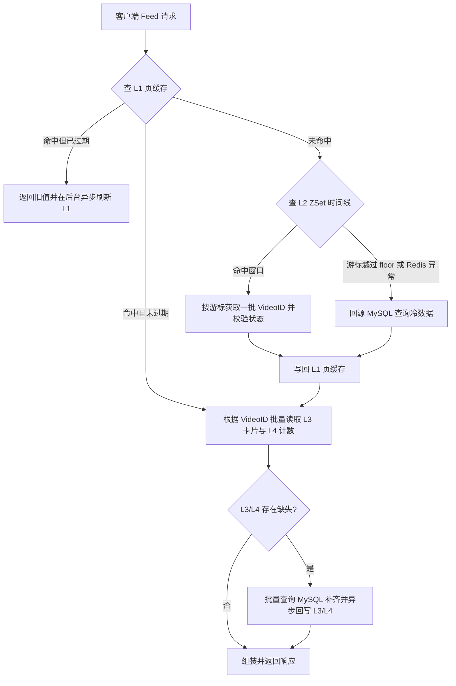

# GoRangeFeed 系统技术方案

> 本文档定义 GoRangeFeed 短视频流系统的架构设计、核心链路方案与技术决策规范。

---

## 一、系统定位与范围

### 1.1 项目定位
GoRangeFeed 是一个短视频 Feed 流后端系统，覆盖「发布 → 分发 → 消费 → 互动 → 通知」全链路闭环，采用单体 API + 独立 Worker 架构，提供可压测、可复现、生产就绪的工程实现。

### 1.2 交付范围划分

| 阶段 | 交付内容 | 包含功能 | 移出/延后理由 |
|---|---|---|---|
| **一期（M0–M5）**<br>MVP 核心闭环 | 六域闭环 + 单实例 SSE | • **account**：注册、登录、双 Token 轮转、资料<br>• **video**：单文件上传、发布、详情、下架<br>• **interaction**：点赞/取消、评论（支持幂等）<br>• **relation**：关注/取关、关注/粉丝列表<br>• **feed**：全局最新流、关注流（推拉结合）、单调 ID 游标<br>• **notification**：通知落库、未读计数、单实例 SSE | 确保核心闭环端到端跑通 |
| **二期（M2.5/M5.5/M6）**<br>扩展与演进 | 分片上传、跨实例推送、多路召回与压测 | • **M2.5**：分片上传、断点续传、同文件秒传<br>• **M5.5**：基于 Redis Pub/Sub 的跨实例 SSE 推送<br>• **M6**：高并发压测调优与候选池精排 | 属于进阶能力，不阻塞一期主链路交付 |
| **明确不做** | — | 转码抽帧、推荐算法深度调优、审核后台、私信、收藏夹 | 避免非核心功能引发范围蔓延 |

---

## 二、架构设计与工程约束

### 2.1 整体架构拓扑
系统采用**垂直切片架构（Vertical Slice）**，按业务领域组织代码结构，杜绝空壳分层：

```
gorangefeed/
  cmd/
    api/                   # HTTP 入口：依赖装配、中间件挂载、路由注册、优雅停机
    worker/                # 异步 Worker：Outbox 调度器与事件消费者
  internal/
    account/               # 账号域：用户注册登录、双 Token 鉴权
    video/                 # 视频域：视频上传、元数据管理与下架
    interaction/           # 互动域：点赞、评论（支持 IdempotencyKey）
    relation/              # 关系域：用户关注、粉丝
    feed/                  # Feed 域：全局时间线、推拉结合关注流、多级缓存与游标分页
    notification/          # 通知域：通知落库、未读数、SSE 实时推送
    outbox/                # 可靠事件投递：事务内落库、分布式租约派发
    infra/                 # 基础设施实现：MySQL、Redis、RabbitMQ、JWT、Config、Metrics
  migrations/              # 数据库版本化迁移脚本（golang-migrate 格式）
  scripts/                 # 验收与压测脚本（e2e.sh）
  web/                     # 前端静态资源目录（一期留空占位）
```

### 2.2 核心工程纪律与中间件规范
1. **按域分包，包内分层**：领域模型与逻辑紧凑内聚，不抽象虚设的多层接口。
2. **消费者侧定义接口**：Repository 等外部依赖接口由业务调用方声明，实现由 `internal/infra` 提供；域间不直接依赖对方的 Repository 实现。
3. **跨域通过 Service 或只读视图交互**：严禁跨域直接操作对方数据库表。
4. **统一协议与规范**：
   - **路由前缀**：公网 API 统一为 `/api`，内部受信接口为 `/internal`（独立 Token 校验）。
   - **响应格式**：成功 `{"data": ..., "error": null}`；失败 `{"data": null, "error": {"code": "...", "message": "..."}}`。
   - **错误码枚举**：使用字符串定义（`invalid_param`、`unauthorized`、`forbidden`、`not_found`、`conflict`、`rate_limited`、`internal`）。
   - **分页规范**：统一游标分页 `{"items": [...], "next_cursor": "...", "has_more": true}`，游标对前端透明。
   - **时间规范**：统一输出 UTC RFC3339。
   - **媒体访问（HTTP 206 Range）**：文件资源统一通过 HTTP 路由（如 `/media/...`）或预签名 URL 提供，严禁暴露宿主机文件路径；**视频流媒体路由原生支持 HTTP 206 Partial Content（Range 请求）**，保障浏览器拖拽播放与边下边播体验。
   - **同源反代部署**：默认前端与 `/api` 挂在同源反代下，避免 CORS 与跨域 Cookie 复杂性。
5. **核心中间件矩阵**：
   - **`JWTAuth` 与 `SoftJWTAuth`**：写接口强制认证；Feed 浏览与视频详情挂载 `SoftJWTAuth`（无凭证视为游客匿名流，有合法凭证则注入 `userID`，用于查询点赞/关注态）。
   - **`RateLimiter` 接口频控**：基于 Redis `INCR + PEXPIRE` 实现原子滑动窗口限流器，按 IP 限制登录注册（10次/分/IP），按 UserID 限制点赞/评论/关注（30次/分/UID），超限拦截返回 `rate_limited`。
   - **`Prometheus Metrics`**：使用 `client_golang` 注册核心耗时直方图与计数器，通过 `/metrics` 端点导出标准指标。

### 2.3 技术栈选型

| 组件 | 选型 | 决策依据 |
|---|---|---|
| 语言与框架 | Go 1.22+ / Gin | 标准库生态完善，Gin 路由表达清晰，生态中间件（鉴权/限流/Recovery）成熟 |
| 关系型数据库 | MySQL 8.0 / GORM | 强事务与行级锁保障核心交易事实正确，结合 GORM 提高开发效率 |
| 缓存与索引 | Redis 7.0 | 提供高性能 Sorted Set 时间线索引、限流计数与多级页面缓存 |
| 消息队列 | RabbitMQ | 提供可靠的 ACK、持久化队列与消息重试机制 |
| 数据库迁移 | golang-migrate | 规范化版本追踪与 dirty 状态管理，历史迁移由 CI 严格校验不变性 |
| 日志与监控 | `log/slog` + Prometheus | 标准库结构化日志零第三方依赖；Prometheus 导出云原生标准监控指标 |

---

## 三、核心链路设计

### 3.1 Feed 读路径与多级缓存体系

#### 3.1.1 缓存层级与职责

| 层级 | 缓存内容 | 存储形式 / Key 规则 | TTL | 作用与策略 |
|---|---|---|---|---|
| **L1 页缓存** | 一页有序的 **VideoID 列表** + 下页游标 | `feed:page:{scene}:{viewer}:{cursor}:{limit}:{rankVersion}` | 首页 5s / 翻页 45s | 阻断高频重复查询；逻辑过期 + singleflight |
| **L2 时间线索引** | 72h 滑动窗口内所有 VideoID | ZSet `timeline:global`（score=video.id） | **永不过期** | 排序权威源，严格维持游标顺序；生命周期由后台裁剪控制 |
| **L3 视频卡片** | 单条视频展示信息（标题/封面/作者信息） | String `feed:card:{videoID}:{rankVersion}` | 15 min | 跨用户共享，ID 批量 MGET 回填 |
| **L4 实时计数** | 视频的点赞/评论/播放计数 | String `feed:stat:{videoID}` | 15 s | 变化频繁，短 TTL 缓存，回源 DB |
| **L5 MySQL** | 权威事实数据 | 表 `videos`, `video_stats` | 持久化 | 兜底与冷数据查询 |

> 注：`{viewer}` 针对匿名用户记录为 `anon`，登录用户记录为 `uid:{id}`，杜绝匿名与个性化流串联。L1 仅缓存 ID 列表，卡片与计数由 L3/L4 组装，避免卡片在多个用户的页缓存中重复冗余。

#### 3.1.2 Feed 请求流转逻辑


#### 3.1.3 L1 逻辑过期与 Singleflight 重建
- **数据结构**：Value 统一存为 `{"payload": "...", "expire_at": 1729700000}`。
- **并发控制**：未命中时使用 `singleflight.Group` 针对同一缓存 Key 进行进程内并发合并，确保瞬时高并发下仅 1 个协程打向底层。
- **降级保护**：旧值最大容忍服务时间 `maxStale = 30s`；异步刷新若连续失败 3 次，立刻退化为同步读 DB 兜底并上报指标。

#### 3.1.4 L2 时间线滑动窗口与原子裁剪
1. **排序与游标统一定义**：
   - ZSet 的 score 使用自增单调的 `video.id`，member 为 `video.id`。
   - 游标直接复用 `video.id`，翻页命令：`ZREVRANGEBYSCORE timeline:global (cursorID -inf LIMIT 0 N`。
   - **架构约束**：MVP 阶段“视频发布”即执行 `INSERT INTO videos`，不存在草稿态；自增 ID 严格保证了创建时序单调性。若未来引入草稿与定时发布，必须引入独立的单调发布序号 `publish_seq` 替代 `id`。
2. **Floor 边界与区间互补**：
   - 窗口维持 72 小时内的最新内容。通过定时任务计算分界点：
     ```sql
     SELECT MIN(id) FROM videos WHERE status='published' AND published_at >= NOW() - INTERVAL 72 HOUR;
     ```
   - 分界值记为 `timeline:floor`。Redis 保留 `score >= floor`，冷区 DB 承接 `id < floor`。
   - 采用 Lua 脚本保证 Redis 裁剪与 Floor 写入原子完成：
     ```lua
     -- KEYS[1]=timeline:global, KEYS[2]=timeline:floor, ARGV[1]=newFloor
     redis.call('ZREMRANGEBYSCORE', KEYS[1], '-inf', '(' .. ARGV[1])
     redis.call('SET', KEYS[2], ARGV[1])
     ```
3. **已下架数据过滤与游标推进**：
   - 批量拉取 `batch = max(limit * 2, 50)` 条记录，过滤掉非 `published` 状态视频。
   - **游标推进原则**：下页 `next_cursor` 必须推进到**最后扫描到的 VideoID**（而非最后返回的有效 VideoID），避免已下架视频在后续翻页中被重复扫描。
   - 单次请求最大扫描限制为 500 条，触碰上限时即便不满页也返回当前已过滤数据，标记 `has_more = true`。

#### 3.1.5 关注流推拉结合架构（Hybrid Push-Pull）
针对关注流的大 V“写放大”问题，采用经过工业验证的推拉结合模式：
1. **写路径分流（Outbox 事件驱动）**：
   - **普通作者（粉丝数 < 5000）**：发布视频触发 Outbox 派发事件，Worker 执行写扩散（Fanout），写入所有粉丝的 Redis Inbox ZSet：`feed:following:inbox:{uid}`（score = video.id）。
   - **大 V 作者（粉丝数 ≥ 5000）**：发布时不扩散给数万粉丝，仅写入作者专有的 Redis Outbox ZSet：`feed:following:author:{author_id}`（score = video.id）。
2. **读路径聚合**：
   - 用户拉取关注流时，Pipeline 并行读取用户的 Inbox ZSet 和关注的所有大 V 的 Outbox ZSets。
   - 在内存中按 score（即单调 video.id）执行多路归并排序并裁剪分页。
   - Redis 缓存缺失或冷启动时，平滑降级回源 MySQL `follows` 联表查询兜底。

---

### 3.2 互动写路径与数据一致性

#### 3.2.1 事实与派生（投影）分离

| 类别 | 包含实体 | 写入方式 | 一致性保障 |
|---|---|---|---|
| **权威事实** | 点赞关系、关注关系、视频元数据、评论及各自主体计数 | **MySQL 事务同步写入** | 强一致，成功即持久化 |
| **持久派生（投影）** | 系统通知记录、热榜聚合打分、关注流分发 | **Outbox + 异步 Worker 消费** | 最终一致（P99 < 1s） |
| **即时提示（可丢）** | SSE 在线未读推送 | **Redis Pub/Sub 广播** | 允许瞬态丢失，客户端补拉保证完整 |

#### 3.2.2 高并发点赞与评论幂等性

**1. 点赞原子计数**：
点赞关系与计数更新在同一个 MySQL 事务内完成。为防止重复点赞或网络重试导致计数漂移，依赖数据库执行影响行数进行原子驱动：
```sql
-- 1. 尝试插入点赞记录（若已点赞则无变更）
INSERT INTO likes (user_id, video_id) VALUES (?, ?) 
ON DUPLICATE KEY UPDATE id = id;

-- 2. 仅当真正发生插入（RowsAffected == 1）时才递增计数
UPDATE video_stats SET like_count = like_count + 1 WHERE video_id = ?;

-- 取消点赞同理：
DELETE FROM likes WHERE user_id = ? AND video_id = ?;
-- 仅当 RowsAffected == 1 时递减，GREATEST 防负数：
UPDATE video_stats SET like_count = GREATEST(like_count - 1, 0) WHERE video_id = ?;
```
> **环境依赖约束**：该机制要求 MySQL 连接参数**不得开启 `clientFoundRows=true`**（Go 官方驱动默认关闭），确保无变更更新返回影响行数为 0。

**2. 评论发布幂等性**：
- 客户端发表评论时生成唯一 UUID `idempotency_key`。
- `comments` 表通过唯一索引 `UNIQUE (user_id, idempotency_key)` 约束单用户幂等性。
- 客户端网络抖动重试命中唯一键时，服务端直接加载并返回已创建的评论记录与最新计数，杜绝脏数据。

#### 3.2.3 Outbox 可靠事件派发机制

```sql
CREATE TABLE outbox (
  id BIGINT AUTO_INCREMENT PRIMARY KEY,
  event_id CHAR(36) NOT NULL UNIQUE,
  event_type VARCHAR(64) NOT NULL,
  payload JSON NOT NULL,
  status ENUM('pending', 'sending', 'sent', 'dead') NOT NULL DEFAULT 'pending',
  attempts INT NOT NULL DEFAULT 0,
  next_retry_at DATETIME NOT NULL,
  lease_token CHAR(36) NULL,
  lease_until DATETIME NULL,
  last_error TEXT NULL,
  created_at DATETIME NOT NULL,
  sent_at DATETIME NULL,
  KEY idx_dispatch (status, next_retry_at, id),
  KEY idx_lease (status, lease_until),
  KEY idx_lease_token (lease_token)
);
```

1. **事务写入**：业务数据操作与 `outbox` 记录插入在同个本地事务中提交。
2. **过期租约回收**：调度循环前先收回超期处于 `sending` 的行：
   ```sql
   UPDATE outbox
      SET status = 'pending', lease_token = NULL, lease_until = NULL
    WHERE status = 'sending' AND lease_until < NOW();
   ```
3. **抢占式领取（分布式租约）**：生成实例专有的 UUID `lease_token`，批量抢占待投递事件：
   ```sql
   UPDATE outbox
      SET status = 'sending', lease_token = ?, lease_until = NOW() + INTERVAL 30 SECOND, attempts = attempts + 1
    WHERE status = 'pending' AND next_retry_at <= NOW()
    ORDER BY id LIMIT 100;
   
   SELECT * FROM outbox WHERE lease_token = ?;
   ```
4. **MQ 确认与状态终结**：投递成功后置为 `sent`；若投递失败，按指数退避计算 `next_retry_at`（1s/5s/25s/2m/10m）；重试超过 10 次置为 `dead` 并触发监控告警。
5. **消费端双层幂等**：
   - **MySQL 层面**：消费事务中首行执行 `INSERT INTO consumed_events (event_id) VALUES (?)`，主键冲突则直接回滚跳过。
   - **Redis 层面**：所有 Redis 派生操作必须天然幂等（如使用 `SET`、`ZADD`，严禁在消费逻辑中使用无边界的 `INCR` 累加）。

---

### 3.3 分布式 SSE 实时通知链路

#### 3.3.1 架构与通信模型
- **拓扑**：API 节点内存中仅维护本地连接映射 `map[userID][]chan Event`。
- **派发**：通知产生后通过 Redis Pub/Sub 发布到 `notify:{userID}` 频道；各 API 实例订阅自身所需频道，命中本地客户端时推入通道。
- **连接保活**：服务端每 15s 发送一次注释行保活心跳；当客户端通道堆满时主动剔除连接，强制客户端重连补拉。

#### 3.3.2 游标设计与弱网补拉
- **游标格式**：复合游标 `{createdAtMs}:{id}`。由于自增 ID 分配与事务提交存在微秒级倒序可能，禁止使用纯自增 ID 作为补拉边界。
- **重叠窗口重拉**：客户端重连时携带 `Last-Event-ID`，服务端回退 60s 窗口范围（从 `cursorTime - 60s` 起拉取），按 `(created_at, id)` 二元组去重后补齐下发。
- **Web 端鉴权**：由于浏览器原生 `EventSource` 不支持自定义请求头，采用一次性短期 Ticket 方案：客户端通过带鉴权头的接口置换 60s 有效期、单次使用且绑定 IP 的 Ticket，通过 URL Query 参数传递建立连接。

---

## 四、数据模型设计

数据库字符集统一采用 `utf8mb4`，时区使用 UTC。系统表结构按迭代阶段渐进引入：

| 引入阶段 | 数据表 | 核心字段 | 关键索引设计 | 职责说明 |
|---|---|---|---|---|
| **M1** | `users` | id, username, password_hash, nickname, avatar_url, bio, status | UNIQUE(`username`) | 用户主表 |
| **M2** | `videos` | id, author_id, title, description, cover_url, play_url, duration_ms, status, published_at | (`status`, `id` DESC)<br>(`author_id`, `status`, `id` DESC)<br>(`published_at`) | 视频主表。`published_at` 专供滑动窗口寻找 Floor |
| **M2** | `video_stats` | video_id(PK), like_count, comment_count, view_count | PRIMARY KEY(`video_id`) | 视频计数表，垂直拆分以隔离高频行级写锁 |
| **M2.5**| `upload_sessions` | id, user_id, file_hash, file_size, chunk_size, total_chunks, uploaded_bitmap, status, expires_at | UNIQUE(`user_id`, `file_hash`)<br>(`status`, `expires_at`) | 分片上传会话。`uploaded_bitmap` 作为分片权威源 |
| **M4** | `likes` | id, user_id, video_id, created_at | UNIQUE(`user_id`, `video_id`)<br>(`video_id`) | 点赞关系表 |
| **M4** | `comments` | id, video_id, user_id, parent_id, content, idempotency_key, status, created_at | UNIQUE(`user_id`, `idempotency_key`)<br>(`video_id`, `status`, `id` DESC) | 评论记录表，唯一键支持请求重试幂等 |
| **M4** | `follows` | id, follower_id, vlogger_id, created_at | UNIQUE(`follower_id`, `vlogger_id`)<br>(`vlogger_id`, `follower_id`) | 关注关系表 |
| **M4** | `relation_stats` | user_id(PK), following_count, follower_count | PRIMARY KEY(`user_id`) | 用户关注与粉丝统计 |
| **M4** | `outbox` | id, event_id, event_type, payload, status, attempts... | 见 3.2.3 节定义 | 本地消息表 |
| **M4** | `consumed_events`| event_id(PK), consumed_at | PRIMARY KEY(`event_id`) | 消费端事务幂等去重表 |
| **M5** | `notifications` | id, recipient_id, actor_id, type, target_id, is_read, created_at | (`recipient_id`, `created_at` DESC, `id` DESC)<br>(`recipient_id`, `is_read`) | 系统通知明细表 |

### 4.1 分片上传状态机与位图控制
- **状态流转**：`init → uploading → merging → completed`（超时或异常转向 `expired / failed`）。
- **权威源定义**：MySQL `upload_sessions.uploaded_bitmap`（`VARBINARY`）为完成度的绝对权威；Redis 仅作为位图读缓存加速分片校验。
- **并发控制**：合并阶段使用分布式锁 `lock:merge:{sessionID}`，防止重试请求并发触发文件合并。

---

## 五、验收标准与核心用例

### 5.1 性能与稳定性目标

| 场景链路 | 对应阶段 | 数据基准 | 压测环境与条件 | 核心指标目标 |
|---|---|---|---|---|
| **Feed 首页流** | M3 | 10,000 视频 / 1,000 用户 | 2C4G 单实例，1,000 并发连接，预热后 | P99 < 80ms，缓存命中率 > 95%，错误率 < 0.1% |
| **Feed 冷区翻页** | M3 | 翻至 72 小时外冷数据 | 100 并发连接回源 DB | P99 < 200ms |
| **视频点赞** | M4 | 针对单一热点视频并发写入 | 300 并发连接持续点赞 | P99 < 120ms，计数零丢失，数据严格一致 |
| **大文件分片上传** | M2.5 | 200MB 视频文件 | 单客户端模拟 3 次网络断连 | 续传成功，无重复分片与脏数据残余 |
| **通知推送** | M5.5 | 1,000 在线订阅用户 | 2 节点跨实例集群 | 实时推送到达率 > 99%，断线补拉 100% 完整 |

### 5.2 必测边界用例集合

| 用例主题 | 构造方式 | 预期断言 |
|---|---|---|
| **Floor 游标临界翻页** | 构造 ZSet 最后一页返回项恰好包含 `floor` 记录 | 下一页请求无缝转查 DB 冷区，`floor` 记录不重复、不遗漏 |
| **连续下架数据补页** | 构造一页请求范围内前 N 条视频全部置为 `deleted` | 自动继续向后扫描补齐目标 `limit` 数量，游标指向最后扫描项 |
| **Redis 击穿降级** | 手动清空或下线 Redis 实例发起 Feed 请求 | 自动平滑降级查 DB，分页与数据正常返回，服务不熔断 |
| **评论重复提交幂等** | 携带相同 `idempotency_key` 并在 50ms 内发起两次评论 | 均返回 200 且返回相同评论 ID，`comment_count` 仅自增 1 |
| **关注流推拉合并** | 关注 1 位普通作者与 1 位大 V 作者并各自发布视频 | 关注流能按统一 score 顺序完整拉取两人作品，无重复与遗漏 |
| **Outbox 租约超时接管** | Worker 抢占租约后强行杀死进程，等待 30s 租约过期 | 租约回收任务自动将任务恢复为 `pending`，由新 Worker 接手且重试次数递增 |
| **死信状态流转** | 模拟消费者持续失败 10 次 | 记录置为 `dead`，告警机制捕获，停止无意义轮询 |
| **重复点赞幂等性** | 同一用户对同一视频在 100ms 内发起 2 次点赞请求 | 两次均返回 200，`like_count` 仅自增 1，数据校验无漂移 |
| **长事务提交补拉** | 模拟通知事务休眠 3 秒后提交 | 客户端通过 60s 补拉重叠窗口能够完整同步该条通知 |
| **SSE 弱网断线恢复** | 客户端断开连接 10s，期间产生 5 条新通知 | 重连携带 `Last-Event-ID` 后能够完整补拉全部 5 条通知 |

---

## 六、阶段检查点（Gate Checkpoints）

在进入对应开发阶段前，必须确认以下设计项已定案并具备验证方案：

### 6.1 CP-M3：全局时间线冷启动与重建
1. **数据回填机制**：系统首次部署或 Redis 宕机冷启动时，`timeline:floor` 不存在则全量直查 DB，同时后台异步根据最近 72h 范围构建初始 ZSet 并原子写入 Floor。
2. **写失效补偿**：发布视频时在事务提交后同步写 Redis ZSet；若 Redis 写入失败仅记录 Warn 日志，由后台定时任务对齐或待缓存重建时自然对齐，不阻断发布成功返回。

### 6.2 CP-M4：Outbox 投递与 MQ 语义
1. **Broker 可靠性**：RabbitMQ 交换机、队列均配置 `durable = true`，消息投递模式设置为 `delivery_mode = 2`（持久化）。
2. **确认机制**：开启 Publisher Confirm 机制，收到 ACK 后方可置 Outbox 状态为 `sent`。
3. **Dead 状态处置**：死信记录仅提供运维管理接口进行手动重放，不进行无限自动循环。

---

## 七、关键技术风险与应对

| 编号 | 风险描述 | 潜在影响 | 防范与应对策略 |
|---|---|---|---|
| **R-01** | 宿主机端口冲突（3306/6379） | 连入非本项目的外部数据库 | Docker Compose 固定映射端口（MySQL: 3307, Redis: 6380, MQ: 5673） |
| **R-02** | 单行热点计数竞争 | 高并发点赞场景下引发 MySQL 行锁积压 | 设定 300 并发基线目标；后续演进可引入 Redis 计数缓冲与批处理回写 |
| **R-03** | 视频发布时序与 ID 倒序 | 游标分页出现逆序或数据遮蔽 | 严守“发布即写入”原则；严禁在 MVP 阶段引入草稿态破坏 ID 单调性 |
| **R-04** | SSE 慢客户端阻塞协程 | 内存占用过高甚至引发服务 OOM | 设置通道缓冲上限，达到阈值直接关闭慢连接，依托补拉恢复 |
